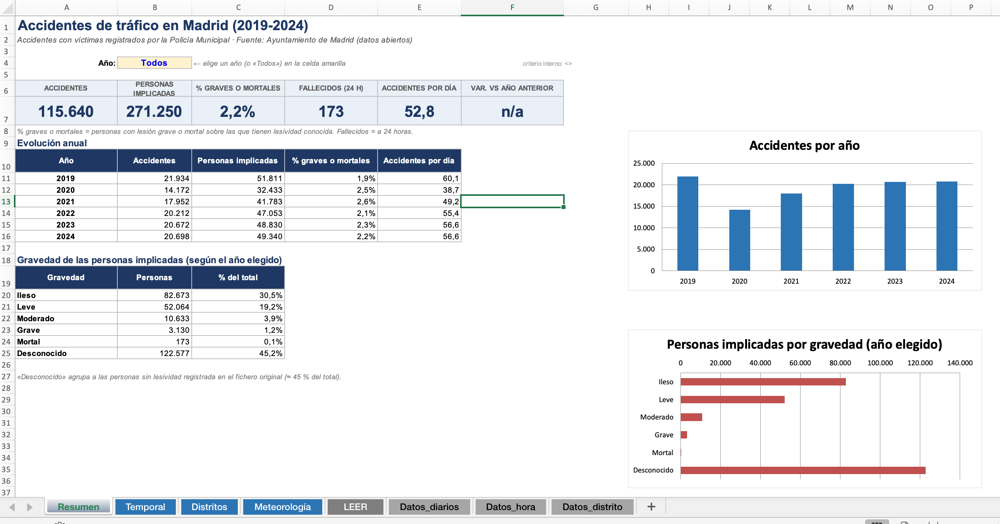
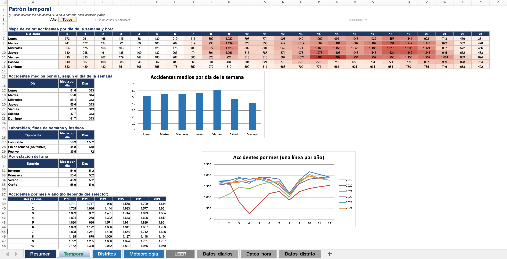

# 🚦 Accidentes de tráfico en Madrid y meteorología (2019-2024)

EDA, análisis estadístico y dashboard sobre la relación entre meteorología, calendario, franja horaria y accidentalidad con víctimas en la ciudad de Madrid.

> **Estado:** limpieza, análisis descriptivo y análisis estadístico completados. Dashboard en Excel e informe PDF en curso.

## 📌 Objetivo
Responder: **¿cómo influyen la lluvia, la temperatura, el calendario y la hora en la frecuencia y la gravedad de los accidentes en Madrid?**

Hipótesis contrastadas (`notebooks/03_estadistico.ipynb`):
- **H1.** La proporción de lesiones graves o mortales depende de la lluvia.
- **H2.** El número de accidentes diarios difiere entre días con y sin lluvia.
- **H3.** El número de accidentes diarios difiere según el día de la semana.
- **H4.** Existe correlación entre temperatura media (y precipitación) y accidentes diarios.
- **H5.** La gravedad se asocia con franja horaria, alcohol, sexo y tipo de vehículo, controlando por lluvia.

## 🗂️ Estructura del repositorio
```
├── data/
│   ├── raw/          # Datos en bruto (2 fuentes) + README de descarga
│   ├── interim/      # Datos limpios por fuente
│   └── processed/    # Dataset final
├── notebooks/        # 01_limpieza · 02_descriptivo · 03_estadistico
├── src/              # config, cleaning, features, stats_utils
├── dashboard/        # Libro de Excel, capturas y guía
├── reports/          # Informe PDF y figuras
├── requirements.txt
└── README.md
```

## 📥 Datos
| Fuente | Origen | Contenido | Filas (bruto) |
|---|---|---|---|
| A | Ayuntamiento de Madrid, datos abiertos («Accidentes de tráfico de la ciudad de Madrid») | Una fila por persona implicada en accidentes con víctimas, 2019-2024 (6 CSV anuales, 19 columnas) | 271.250 (115.640 accidentes distintos) |
| B | AEMET OpenData, estación Madrid-Retiro (3195) | Climatología diaria, 2019-2024 (12 ficheros JSON, peticiones de 6 meses) | ≈ 2.200 (una por día) |

**Dataset final:** `data/processed/accidentes_meteo_madrid.csv` · 271.250 filas × 47 columnas.  En el repositorio va comprimido como `accidentes_meteo_madrid.csv.zip`; se regenera ejecutando los notebooks 01 → 03.
Unión por `fecha` (relación muchos-a-uno, validada con `merge(validate="m:1")`).

## 🛠️ Cómo reproducirlo
```bash
git clone <url-del-repo> && cd proyecto-eda
python3 -m venv .venv && source .venv/bin/activate     # Windows: .venv\Scripts\activate
pip install --upgrade pip
pip install -r requirements.txt
# 1. Descarga los datos siguiendo data/raw/README.md
# 2. Ejecuta los notebooks en orden 01 → 02 → 03 (VS Code o Jupyter)
```
Si en macOS falla la instalación de `argon2-cffi-bindings` (paquete de `jupyter`), instala sin él:
```bash
pip install pandas numpy matplotlib seaborn scipy statsmodels holidays ipykernel scikit-learn
```

## 🔄 Pasos seguidos
1. **Auditoría:** formas, tipos, nulos, duplicados y esquema por año. Los 6 CSV comparten el mismo esquema de 19 columnas.
2. **Limpieza:** normalización de columnas y textos (tildes, mayúsculas), parseo de fechas y horas, coordenadas, tratamiento de `Ip` (precipitación inapreciable) en AEMET y control de incoherencias (tmin > tmax). Decisiones con criterio explícito:
   - **Filas idénticas (11.449): se conservan.** El fichero no tiene identificador de persona y son, en su mayoría, personas distintas del mismo accidente (varios pasajeros, conductores desconocidos).
   - **Lesividad nula (≈ 45 % de las personas): se clasifica como «desconocido»** y se excluye de los análisis de gravedad.
   - **`positiva_droga`:** en el CSV solo aparece `1` (positivo) o nulo; el nulo se interpreta como «no positivo o sin prueba».
   - **Viento (`velmedia`, `racha`):** la estación Retiro no registra viento desde mediados de 2020, por lo que no se usa en el análisis.
3. **Transformación:** gravedad desde el código de lesividad (verificado contra el texto de cada código), franja horaria, estación, festivo (Comunidad de Madrid), fin de semana, lluvia e intensidad, categoría térmica y agregados por accidente.
4. **Unión:** left join por fecha con validación del número de filas.
5. **Descriptivo:** tendencias, distribución horaria y semanal, mapa de calor, distritos y meteorología (8 figuras en `reports/figures/`).
6. **Estadístico:** chi-cuadrado, Mann-Whitney, Kruskal-Wallis con post-hoc (Bonferroni), Spearman, binomial negativa (con `alpha` estimado) y regresión logística con errores robustos por accidente, siempre con tamaños de efecto e intervalos de confianza.
7. **Dashboard** en Excel (tablas dinámicas, segmentaciones y gráficos).
8. **Informe.**

## 📊 Resultados principales
1. **Volumen y tendencia.** 115.640 accidentes con víctimas (271.250 personas) entre 2019 y 2024, con una media de 52,8 accidentes al día. 2020 cayó un 35 % respecto a 2019 (14.172 frente a 21.934 accidentes) y desde 2022 se estabiliza en torno a 20.200-20.700, un 6 % por debajo de 2019.
2. **Calendario y hora.** El viernes es el día con más accidentes (mediana de 65 al día) y el domingo el que menos (42); H3 muestra un efecto moderado (ε² = 0,137). Los festivos tienen un 38 % menos de accidentes (IRR = 0,62; IC 95 % 0,58-0,66). Los picos horarios se dan hacia las 14 h y entre las 18 y las 19 h.
3. **Lluvia y frecuencia.** Los días de lluvia tienen más accidentes: mediana de 57 frente a 52 (Mann-Whitney p < 0,001; efecto pequeño, rank-biserial = −0,13). Controlando calendario y temperatura, el aumento es del 4,6 % (IRR = 1,046; IC 95 % 1,021-1,073).
4. **Lluvia y gravedad.** La lluvia **no** empeora la gravedad: 2,27 % de lesiones graves o mortales sin lluvia frente a 2,09 % con lluvia (V de Cramér = 0,012, efecto despreciable). Aunque el contraste es significativo por el tamaño de muestra (p = 0,0005), no tiene relevancia práctica.
5. **Temperatura.** Correlación débil con los accidentes diarios (ρ = −0,16), explicada en gran parte por la estacionalidad: controlando mes y año, el efecto es de apenas +4 % cada 10 °C.
6. **Factores de gravedad (solo conductores, referencia: turismo).** El tipo de vehículo es el factor dominante: moto de más de 125 cc (OR = 25,1), moto de hasta 125 cc (OR = 16,8) y bicicleta (OR = 14,2). También aumentan el riesgo la madrugada frente a la mañana (OR = 2,2), el fin de semana (OR = 1,2) y el alcohol positivo (OR = 1,34; IC 95 % 1,05-1,70). Las conductoras tienen menor probabilidad de lesión grave (OR = 0,73). En descriptivo, el 6,2 % de las personas en moto sufre lesión grave o mortal, frente al 1,4 % del resto. En total, el 2,2 % de las personas con lesividad conocida sufre una lesión grave o mortal, y hay 173 fallecidos a 24 horas en el periodo.

## 🖥️ Dashboard




## ⚠️ Limitaciones
- Una sola estación meteorológica para toda la ciudad; la lluvia es diaria, no horaria.
- Solo accidentes con víctimas registrados por la Policía Municipal; no hay dato de exposición (volumen de tráfico).
- Cada fila es una persona; los análisis a nivel de accidente usan `num_expediente`. Las personas de un mismo accidente no son independientes: la regresión logística usa errores robustos por accidente, pero el chi-cuadrado de H1 no lo corrige.
- Alrededor del 45 % de las personas no tiene lesividad registrada; si esa ausencia no es aleatoria, puede haber sesgo en los análisis de gravedad.
- La prueba de alcohol no se realiza a todos los implicados (posible sesgo de selección), por lo que H5 se centra en conductores.
- Unos 110 días (≈ 5 %) sin dato de lluvia o temperatura se excluyen de los análisis diarios.
- Sin datos de viento desde mediados de 2020 en la estación utilizada.
- Asociación no implica causalidad.

## ✅ Conclusiones y próximos pasos
**Conclusiones.** La meteorología influye poco: la lluvia aumenta algo la frecuencia de accidentes (+4,6 %) pero no su gravedad, y la temperatura apenas importa una vez se controla la estacionalidad. Pesan mucho más el calendario (viernes, domingo y festivos), la franja horaria y, sobre todo, el tipo de vehículo, con las motos y las bicicletas muy por encima del turismo.

**Próximos pasos.**
- Incorporar más estaciones de AEMET o datos horarios para captar mejor la lluvia en el momento del accidente.
- Añadir datos de exposición (intensidad de tráfico del Ayuntamiento) para analizar el riesgo y no solo el recuento.
- Explorar el análisis espacial con las coordenadas UTM (puntos negros por distrito o calle).
- Probar modelos con la lluvia horaria y su interacción con la franja horaria.

## 🧰 Tecnologías
Python · pandas · SciPy · statsmodels · seaborn/matplotlib · Visual Studio Code · Excel

## 👤 Autor
_(Miguel Fernández Fernández · www.linkedin.com/in/miguel-f-f · https://github.com/miguelffer12)_

_Fuentes: Ayuntamiento de Madrid (datos abiertos) y AEMET (licencia de reutilización de datos abiertos)._
